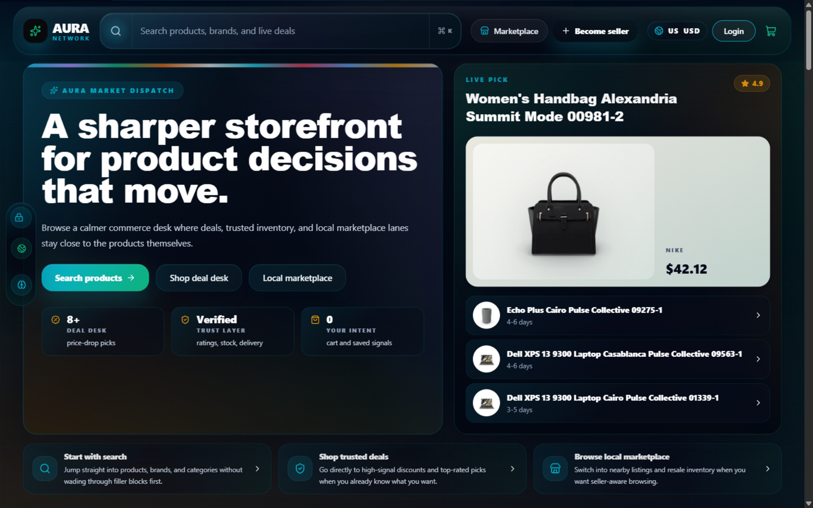
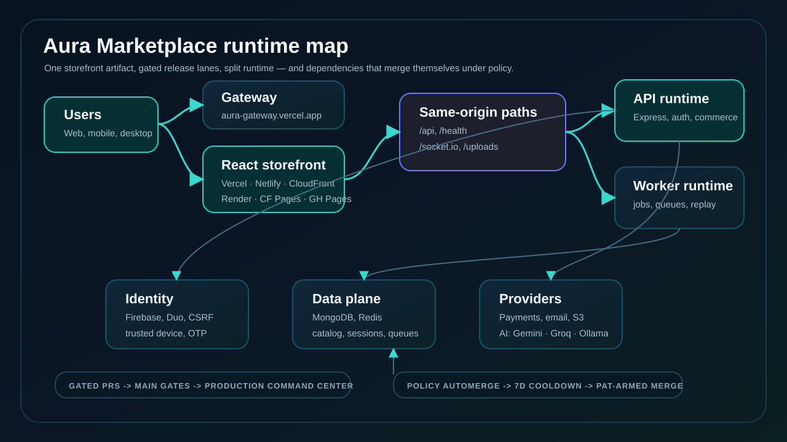
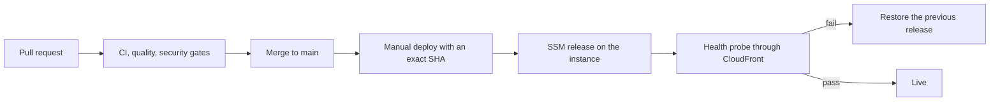

<div align="center">


**A production commerce platform: React storefront, Express/MongoDB core, Electron and Capacitor clients, and a release process built around verification.**

[](https://github.com/MdSaifulIslamMSI/Aura/actions/workflows/quality.yml)
[](https://github.com/MdSaifulIslamMSI/Aura/actions/workflows/security-gates.yml)
[](https://github.com/MdSaifulIslamMSI/Aura/actions/workflows/nightly-tests.yml)
[](LICENSE)

[Storefront](https://aurapilot.vercel.app) &middot; [Gateway](https://aura-gateway.vercel.app) &middot; [Status](https://aurapilot.vercel.app/status) &middot; [Architecture](docs/system-architecture.md) &middot; [Security](SECURITY.md) &middot; [Documentation](docs/)

</div>

<p align="center">
  
</p>

---

## What Aura is

Aura is a working marketplace, not a UI demo. It runs at [aurapilot.vercel.app](https://aurapilot.vercel.app): browse a faceted catalog, add to cart, check out with a server-validated quote, pay, track an order, request a return, sell an item, or ask the shopping assistant to do it for you.

The repository is the whole system: a React single-page storefront, an Express/MongoDB commerce API and worker, an Electron desktop app, Capacitor mobile shells, a public gateway, infrastructure automation, and the CI that gates all of it. Money, inventory, coupon validity, and authorization are server decisions. The client renders what the API returns.

It is built and operated by one developer working with AI agents. That is why the repo invests heavily in written invariants, explicit contracts, and verification commands: the process has to carry the context that a larger team would.

## At a glance

| Area | Detail |
|---|---|
| Runtime | React 19.3 · Vite 8.3 · Express 5.2 · Mongoose 9.10 · Redis 7 · Node 26 in production images |
| Clients | Web SPA and PWA, Electron 44 desktop, Capacitor 8 (Android + iOS) |
| Test surface | 759 unit/integration test files (239 app, 509 server, 11 desktop) plus 17 Playwright specs |
| Server suites | 509 suites tiered across regression, nightly, targeted lanes, and quarantine; 233 run on every PR, 258 nightly, 0 quarantined |
| CI | 56 GitHub Actions workflows, including 8 rollback lanes |
| Delivery | One storefront release on 6 hosts; SHA-pinned backend releases with a health probe and automatic restore |
| Reach | 20 languages including RTL, 13 markets, 11 currencies |
| Packages | `@aurasec/supply-chain-gates` and `@aurasec/route-security-matrix`, published to npm |

Counts come from `config/test-tiers.json`, the package manifests, `app/src/config/marketConfig.js`, and `.github/workflows/`. The live hosts are probed independently of CI.

## Quick start

**Prerequisites:** Node.js 22.12+ (production containers run Node 26), npm 10+, and MongoDB and Redis. On Windows, the repo can start both services for you.

```sh
git clone https://github.com/MdSaifulIslamMSI/Aura.git
cd Aura
npm install
npm --prefix app install
npm --prefix server install
```

The root install provides the repo scripts and the Electron host; `app/` and `server/` own their dependency trees.

Create the local env files. The examples describe the shape; fill in the services you enable. Never commit real credentials.

```sh
# PowerShell
Copy-Item app\.env.example app\.env
Copy-Item server\.env.example server\.env

# bash / zsh
cp app/.env.example app/.env
cp server/.env.example server/.env
```

Start the local data services, then the two runtimes in separate terminals:

```sh
# Windows: repo-managed MongoDB + Redis
npm run dev:on

# macOS / Linux: use the compose services, or point MONGO_URI and REDIS_URL
# at instances you already run
docker compose up -d mongo redis

# terminal 1
npm --prefix server start

# terminal 2
npm --prefix app run dev
```

Open <http://localhost:5173>. The backend listens on `5000`; Vite proxies `/api`, `/health`, and `/uploads` there. Confirm the API directly:

```sh
curl http://127.0.0.1:5000/health
```

Stop the Windows services with `npm run dev:off` (`dev:off:force` only if something refuses to stop).

## Repository map

| Path | Owns |
|---|---|
| [`app/`](app/) | React storefront, AI assistant, admin suite, PWA, Capacitor shells, Playwright E2E. See [app/README.md](app/README.md). |
| [`server/`](server/) | Express API, worker runtime, auth and sessions, catalog, cart, orders, payments, AI gateways, background jobs. |
| [`desktop/`](desktop/) | Electron main process, OS-keychain storage, loopback auth handoff, hardened outbound proxy. |
| [`gateway/`](gateway/) | Static public gateway and release-link directory. |
| [`packages/`](packages/) | The two CI gate engines that are also published to npm. |
| [`infra/`](infra/) | AWS and edge deployment, rollback scripts, Docker Compose stacks, OpenTofu, PQC lab. |
| [`scripts/`](scripts/) | CI doctors, validators, generators, smoke and release tooling. |
| [`docs/`](docs/) | Architecture, security, payments, SRE, runbooks, ADRs. Start at [system architecture](docs/system-architecture.md). |
| [`config/`](config/) | Test tiers, dependency policy, environment examples, and runtime guard configs. |

## Architecture

<p align="center">
  
</p>
<p align="center">
  <sub>One release, six hosts. Vercel, Netlify, and Render proxy same-origin runtime paths to the shared CloudFront edge; the AWS CloudFront host is that edge. Cloudflare Pages and GitHub Pages call it directly. The gateway is a separate static directory.</sub>
</p>

The storefront is one Vite app. Vercel, Netlify, and Render rewrite `/api`, `/health`, `/socket.io`, and `/uploads` to the shared CloudFront edge, so runtime calls stay same-origin on those lanes. The AWS CloudFront lane is that edge: its S3 default behavior serves the same release, and its runtime behaviors forward to the backend. Cloudflare Pages and GitHub Pages are deployed without a rewrite layer; the same bundle calls the edge directly and depends on the backend CORS allowlist. Render rebuilds from the same commit and build inputs, and a post-deploy coherence gate hashes what every host serves, so a rebuild lane cannot drift. Routing is a hosting contract, not a runtime service.

The backend runs on one EC2 host as two processes from one immutable image:

- **API** — Express routes, middleware, Firebase-authenticated Socket.IO entrypoints with a Redis backplane, session enforcement, and health checks.
- **Worker** — payment outbox, order email, catalog imports, reconciliation, lifecycle jobs, analytics, status, and OTP maintenance, with its own readiness probe.

MongoDB is the transactional store. Redis coordinates rate limits, queues, realtime, and distributed security controls. Uploads use S3, and AWS Parameter Store is the source of truth for runtime secrets.

Production runs the assistant without an LLM: `AI_MODEL_PROVIDER=disabled`, no fallbacks, and no model summary. Hosted model keys are optional and non-production. The gateway at `aura-gateway.vercel.app` is a separate static directory for storefront links and verified downloads; it carries no API traffic.

Identity is Firebase, but authorization is server-side. A verified Firebase token is exchanged for an opaque browser session with rotation, CSRF token pairs, and revocable lineage. Sensitive actions can require a fresh factor: passkey or TOTP for MFA, trusted-device verification, admin step-up, or Duo OIDC. Session assurance is time-bounded and re-checked on every request that depends on it.

Further reading: [system architecture](docs/system-architecture.md) · [split runtime](docs/split-runtime-deployment.md) · [environment contract](docs/environment-contract.md) · [trusted-device architecture](docs/trusted-device-architecture.md)

## What you can do

| Surface | Product behavior | Engineering notes |
|---|---|---|
| **Catalog** | Faceted browse with URL-round-trip filters, search and visual search, recommendations, price alerts, bundles, product pages with rating breakdowns and photo reviews. | Server-side filtering and sort indexes; Atlas Search with a logged regex fallback. |
| **Cart and checkout** | Guest cart and wishlist merge on login; four-step checkout; OTP challenge; COD, UPI, card, wallet, and net-banking. | Optimistic mutations with revision-conflict replay and `BroadcastChannel` cross-tab sync. Totals and coupons are server-validated. |
| **Orders** | Tracking, downloadable invoices, cancellation, returns, refunds. | Lifecycle workers, courier webhooks with per-provider HMAC, dedupe ledgers, and COD aging alerts. |
| **Assistant** | Terminal-style page and a page-context dock; navigate, search, add to cart, apply coupons, start checkout, cancel orders, create returns. | A grounded loop intersects model output with observed product IDs. Destructive actions are confirmation-gated by a capability manifest shared with the backend. |
| **Marketplace** | C2C listings, seller profiles, sell flow, seller listing management. | Listing visibility and moderation enforced in the API, not the client. |
| **Admin** | Dashboard, products, orders, payments, refund ledger, users, support, email operations, diagnostics, status, and emergency kill switches. | Every state-changing route declares its security posture; a matrix test derives the route list from source. |
| **Clients** | Installable PWA; Electron desktop with OS-keychain storage and loopback auth handoff; Capacitor shells for Android and iOS. | Desktop release artifacts carry provenance attestations; mobile navigation uses a concrete allowlist, never a wildcard. |

Money is deliberately boring:

- A double-entry ledger records platform cash, fees, processor clearing, receivables, wallets, pending refunds, and disputes in minor units.
- Razorpay is the default provider. When Stripe routing is explicitly enabled, a weighted heuristic scores fee, configured health, latency, and BIN affinity. Production credentials are validated at boot; missing values fail closed.
- Webhooks verify HMAC over raw bytes, anchor idempotency in MongoDB, reject replayed payment references, and make capture transitions conditional so a provider-side double capture cannot strand an order.

## Quality and security gates

Every change is verified by the narrowest meaningful check; CI owns the broad matrix.

| Trigger | Workflows | Covers |
|---|---|---|
| Pull request | `ci.yml`, `quality.yml`, `security-gates.yml` | Changed-surface tests, lint, frontend build, sharded server suites, scanners, route and contract checks |
| Push to `main` | `quality.yml`, `security-gates.yml` | Full quality matrix and security scans; merge does not re-run the PR-only `ci.yml` |
| Nightly | `nightly-tests.yml` | Full server fleet, performance, and scheduled checks |
| Manual | `all-suites.yml` | Fans out CI, nightly, and quality in one dispatch |

Backend suites live in [`config/test-tiers.json`](config/test-tiers.json), split into regression, nightly, targeted lanes, and quarantine. The untriaged count must stay at zero; `node scripts/check-test-tiers.cjs` fails the ratchet when it grows.

Supply-chain controls are part of the same gate: every lockfile resolution must come from the official npm registry with an integrity hash, install scripts are allowlisted, and newly introduced versions wait out a 7-day release cooldown. The automerge controller can stall or label a dependency PR, but it cannot merge past a failing check or branch protection. Policy lives in [`config/dependency-policy.json`](config/dependency-policy.json).

Run the check that matches your change:

| Change | Command |
|---|---|
| Frontend unit behavior | `npm --prefix app test` |
| Frontend build and bundle budgets | `npm --prefix app run build` · `npm run perf:budget` |
| Backend focused suite | `npm --prefix server test -- --runTestsByPath tests/<name>.test.js` |
| Backend regression tier | `npm test` |
| Browser flows | `npm --prefix app run test:e2e` |
| CI wiring and repo health | `npm run ci:doctor` · `npm run quality:actions` |
| Environment contract | `npm run smoke:env-contract` |
| Route security coverage | `npm run security:routes:coverage:strict` |
| Test-tier triage | `node scripts/check-test-tiers.cjs` |

The full ladder, including auth, staging, and release checks, is in [AGENTS.md](AGENTS.md).

## Release and operations



**Backend.** `deploy-backend-aws.yml` is dispatched manually with a `git_ref`. A ref guard refuses anything that is not an ancestor of `main`, the release is built once, and the exact SHA becomes the image tag. The default strategy is `swap` (recreate, brief downtime). Blue-green is implemented but refuses to run unless `AURA_BLUE_GREEN_ENABLED` is set after an explicit staging drill, so production never improvises a slot switch. A failed post-activation check restores the previous release.

**Frontend.** One release serves six hosts: the same `app/dist` artifact is published to five, and Render rebuilds from the same commit and inputs. The workflow re-fetches each host's shell and every referenced asset, hashes them with SHA-256, and fails closed on any mismatch. Each build exposes `aura-release-id` and `aura-release-commit` meta tags; those tags, the workflow run, and a direct probe are the source of truth for what is live.

**After any deploy, probe the running system.** A green workflow proves the workflow was green, not that the change is serving. Check the live endpoint, diff the response shape against the pre-deploy state, and establish liveness before reading logs if a later step failed.

**Observability.** The API exposes `/health`, `/health/live`, and `/health/ready`; the worker has its own readiness probe. `/metrics` is token-protected. The repo ships an OpenTelemetry, Prometheus, Grafana, Loki, Promtail, and Alertmanager stack under [`infra/observability/`](infra/observability/); host activation is an explicit workflow. Sentry and Datadog browser monitoring are opt-in from the storefront. A status service polls dependencies every five minutes, accepts Alertmanager and GitHub Actions webhooks, and publishes the public [status page](https://aurapilot.vercel.app/status); a workflow watcher reports CI health.

Runbooks: [rollback](docs/rollback-runbook.md) · [incident](docs/incident-runbook.md) · [payments](docs/payment-runbook.md) · [performance](docs/performance-runbook.md)

## Security posture

Enforced in the running system:

- Server-side sessions with rotation, revocation, CSRF token pairs, and time-bounded step-up. Passkeys/WebAuthn, TOTP, recovery codes, trusted devices, and Duo OIDC are all first-class factors.
- Field-level AES-256-GCM encryption with AWS KMS-wrapped data keys and HMAC blind indexes, so encrypted phone and email fields stay searchable without plaintext fallback.
- A route-security matrix that derives every route from source and fails CI unless each state-changing route declares and enforces its posture.
- Scanner coverage includes CodeQL, Semgrep, Gitleaks, Trivy, Checkov/tfsec/Terrascan, OSV, zizmor, OpenSSF Scorecard, and dependency review.
- Origin protection: CloudFront injects `X-Aura-Origin-Verify`; the backend rejects protected routes without it and fails closed in production if the secret is missing. Health, metrics, and signed provider/status webhooks are the explicit bypass list. Direct origin probes time out.

Deliberately not enabled, or still incomplete:

- **AWS WAF is not active in the current account.** It was removed as a cost cut. The $0 self-hosted ModSecurity/CRS + CrowdSec stack in [`infra/edge/`](infra/edge/) is exercised by `edge-waf-verification.yml`, but it is not the current production front door; CloudFront plus the application-layer origin guard are.
- **Desktop signing is partial.** The standalone release workflow requires Windows Authenticode by default, but the production pipeline passes the unsigned lane and the free tier has no certificate. Unsigned builds cannot verify update signatures; this is accepted risk [R-026](docs/security/risk-register.md). macOS signing and notarization are not implemented, so macOS artifacts are unsigned.
- **Blue-green is opt-in only.** It stays disabled until a staging drill validates it.
- **Live payment-provider webhooks** are exercised with signed fixtures in CI. End-to-end validation against real Razorpay or Stripe accounts needs provider credentials that CI does not hold.
- **Post-quantum work** is a lab and readiness track, not a production claim.

Further reading: [security architecture](docs/security/security-architecture.md) · [threat model](docs/security/threat-model.md) · [zero-trust sensitive actions](docs/security/zero-trust-sensitive-actions.md) · [secretless frontend](docs/security/secretless-frontend.md)

## Configuration

- `app/.env.example` and `server/.env.example` document the supported variables and their expected shapes. Values are examples, not credentials.
- **Everything prefixed `VITE_` is public.** Vite inlines those values into the bundle. Secrets belong on the backend, never in `app/.env`.
- Production reads secrets from AWS Systems Manager Parameter Store. Environment contracts are validated in CI and at startup; missing required values fail closed.

| Group | Examples | Notes |
|---|---|---|
| Identity | `VITE_FIREBASE_*`, `VITE_TURNSTILE_SITE_KEY` | Firebase web config and public challenge keys |
| Sessions and security | `SESSION_SECRET`, `SESSION_HASH_SECRET`, `AUTH_RISK_SIGNAL_SECRET`, `HEALTH_READY_TOKEN` | Server-only; generated per environment |
| Data and realtime | `MONGO_URI`, `REDIS_URL`, `REDIS_REQUIRED`, `SPLIT_RUNTIME_ENABLED` | Mongo is transactional; Redis is coordination |
| Payments | Razorpay and Stripe provider credentials | Absent credentials fail closed in production |
| AI providers | Gemini, Ollama, OpenCode Zen, Groq, Voyage, ElevenLabs, LiveKit | All optional; the assistant route is disabled when no provider is configured |
| Observability | `METRICS_SECRET`, Sentry and Datadog keys | `/metrics` is token-protected |

## Documentation map

**Architecture and operations** — [system architecture](docs/system-architecture.md) · [CI/CD and the production command center](docs/ci-cd.md) · [split runtime](docs/split-runtime-deployment.md) · [environment contract](docs/environment-contract.md) · [AWS backend](docs/aws-backend-deployment.md) · [AWS frontend](docs/aws-frontend-deployment.md) · [mobile delivery](docs/mobile-app-delivery.md)

**Security** — [security architecture](docs/security/security-architecture.md) · [threat model](docs/security/threat-model.md) · [zero-trust sensitive actions](docs/security/zero-trust-sensitive-actions.md) · [secretless frontend](docs/security/secretless-frontend.md) · [route exposure registry](docs/security/route-exposure-registry.md) · [post-quantum readiness](docs/security/post-quantum-readiness.md)

**Money and data** — [payment architecture](docs/payment-architecture.md) · [payment runbook](docs/payment-runbook.md) · [critical invariants](docs/critical-invariants.md) · [database audit](docs/database-audit-2026-09-07.md)

**Performance and reliability** — [performance contract](docs/performance-contract.md) · [budgets](docs/performance-budgets.json) · [SLOs](docs/sre/slo.md) · [latency and reliability budgets](docs/sre/latency-and-reliability-budgets.md) · [rollback runbook](docs/rollback-runbook.md) · [operational runbooks](docs/runbooks/)

**Decisions** — [architecture decision records](docs/adr/) · [dependency automation](docs/dependency-automation.md) · [security scanning](docs/security-scanning.md)

## Contributing, security, and license

- **Contributing:** [CONTRIBUTING.md](CONTRIBUTING.md). Keep changes surgical, run the check that covers the touched surface, and add tests for anything money- or auth-adjacent. Agent-assisted changes must also follow [AGENTS.md](AGENTS.md).
- **Security:** [SECURITY.md](SECURITY.md). Do not open a public issue for a vulnerability; the disclosure path and evidence live there.
- **License:** [ISC](LICENSE).

**Project status:** active and in production, maintained by one developer with AI-assisted workflows. Issues and pull requests are welcome; review time is best-effort.
