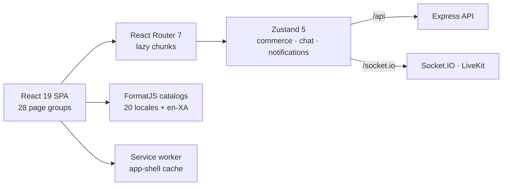

<div align="center">


**The React storefront for Aura Marketplace.**

28 page groups · 20 locales + `en-XA` · 11 currencies · 6 byte-identical production hosts

[](https://github.com/MdSaifulIslamMSI/Aura/actions/workflows/quality.yml)
[](https://github.com/MdSaifulIslamMSI/Aura/actions/workflows/codeql.yml)
[](https://react.dev)
[](https://vite.dev)
[](https://tailwindcss.com)

[Live storefront](https://aurapilot.vercel.app) &middot; [Gateway](https://aura-gateway.vercel.app) &middot; [All hosts](#one-artifact-six-hosts) &middot; [Root README](../README.md) &middot; [Architecture](../docs/system-architecture.md) &middot; [CI/CD](../docs/ci-cd.md)

</div>

<p align="center">
  
</p>

---

## What this app is

`app/` is the customer-facing React application for Aura Marketplace. It owns everything a shopper or seller touches: catalog discovery, product detail, cart and checkout, orders and returns, the AI shopping assistant, the C2C marketplace, account security, and the admin console.

It is a static single-page application. `vite build` emits one `dist/` artifact, and that exact artifact is published to six hosts. Runtime calls use same-origin paths — `/api`, `/health`, `/socket.io`, `/uploads` — so the storefront and backend can live on different origins without CORS drift.

The client is deliberately thin on trust. Prices, totals, coupon validity, payment capture, inventory, and authorization are decided by the backend. The storefront renders what the API returns and never treats its own state as authoritative for money.

## At a glance

| | |
|---|---|
| Framework | React 19.3 + Vite 8.3, JavaScript/JSX |
| Routing | React Router 7.18 with lazy page groups |
| Styling | Tailwind CSS 4.3, Radix Slot, framer-motion 13 |
| State | Zustand 5 stores + React context; optimistic commerce runtime |
| i18n | FormatJS / react-intl 12; 20 locales, RTL, `en-XA` pseudo-locale |
| Realtime | Socket.IO client 4.8, LiveKit 2.22 |
| Identity | Firebase 12 web SDK, Turnstile, WebAuthn, device trust, Duo step-up |
| Telemetry | Sentry 10 and Datadog RUM, both opt-in and env-gated |
| Tests | 239 Vitest files, 17 Playwright specs |
| Ships to | Vercel, Netlify, CloudFront, Render, Cloudflare Pages, GitHub Pages |

## Feature map

**Catalog and discovery**
- Faceted catalog whose filters round-trip through the URL, so a filtered view is linkable and reload-safe.
- Search, visual search, recommendations, price alerts, and product bundles.
- Product detail with rating breakdowns and photo reviews.

**Cart and checkout**
- Optimistic cart mutations with revision-conflict replay and `BroadcastChannel` cross-tab sync.
- Guest cart and wishlist merge into the account on login.
- Five-step checkout (address → delivery → payment → review), coupons validated against a server-side quote, an OTP challenge, and COD / UPI / card / wallet / net-banking.

**Orders and account**
- Order tracking, downloadable invoices, cancellation, and returns.
- Wishlist, trade-in estimator, Aura Points loyalty, and profile management.

**AI shopping assistant**
- A terminal-style assistant page plus a page-context dock that carries what the shopper is looking at.
- Real actions, not chat alone: navigate, search, open products, add to cart, apply coupons, start checkout, cancel orders, create returns, open tracking. Destructive actions are confirmation-gated through a capability manifest shared with the backend.
- Multimodal input (images and audio), inline product cards, and support-desk handoff.
- The grounded tool loop intersects model output with actually-observed products, and the UI degrades safely when every provider is disabled.

**Marketplace and selling**
- C2C listings, seller profiles, the sell flow, and seller listing management.

**Admin and operations**
- Dashboard, products, orders, payments, refund ledger, users, support, email ops, client diagnostics, and status.
- Feature kill switches and emergency controls surfaced in the admin console.

**Trust and security**
- Firebase identity with server-side sessions, CSRF token pairs, phone OTP, passkeys/WebAuthn, TOTP + recovery codes, trusted devices, Duo OIDC step-up, and Turnstile challenges.
- Request-proof signing (`src/security/requestProofSigner.js`) and a DPoP proof client for sensitive calls.
- Route security posture is enforced by a server-side route matrix test, not by client-side checks.

**Global**
- 20 human locales including RTL Urdu and Arabic, plus an `en-XA` pseudo-locale for layout and truncation QA.
- 11 currencies with region-aware presentation and live FX refresh.

## Architecture



The storefront is a browser application with a narrow runtime boundary:

- **Reads** go through `src/services/api.js` and the runtime-config layer, which resolves the API base once and reuses it.
- **Mutations** carry CSRF token pairs and, where required, request proofs.
- **Realtime** uses authenticated Socket.IO; voice and video ride LiveKit.
- **Money and authorization** never depend on client state. The client can display a total; only the backend can commit it.

## Directory map

| Path | Owns |
|---|---|
| `src/pages/` | 28 page groups: catalog, checkout, orders, assistant, marketplace, admin, status |
| `src/components/ui/` | Reusable primitives and design-system pieces |
| `src/components/features/` | Domain components (commerce, product, marketplace, assistant) |
| `src/components/shared/` | Cross-feature widgets such as global search |
| `src/components/layout/` | Application shell, navigation, footer |
| `src/components/auth/` | Sign-in, challenges, trusted-device flows |
| `src/store/` | Zustand stores and the optimistic commerce runtime |
| `src/services/` | API, assistant, health, CSRF, device trust, telemetry |
| `src/security/` | Request-proof signing and OTP client |
| `src/i18n/` | Message catalogs, compiled ICU bundles, QA tooling |
| `src/config/` | Market definitions, message packs, runtime feature config |
| `src/hooks/` | Shared React hooks |
| `e2e/` | 17 Playwright specs |
| `scripts/` | Build, release, i18n, mobile, and QA automation |
| `public/` | PWA manifest, service worker, icons, status snapshots |
| `android/`, `ios/` | Capacitor native shells |

## Getting started

### Prerequisites

- Node.js 24+ (CI pins `24.x`)
- npm
- The backend from this repository, plus local MongoDB and Redis (`npm run dev:on` at the repo root)

### Run it

```bash
# from the repository root
npm install
npm --prefix app install

cp app/.env.example app/.env      # PowerShell: Copy-Item app\.env.example app\.env
npm run dev:on                    # local MongoDB + Redis

npm --prefix server start         # terminal 1
npm --prefix app run dev          # terminal 2
```

Open <http://localhost:5173>. Vite proxies `/api`, `/health`, and `/uploads` to `VITE_DEV_API_PROXY_TARGET` (default `http://127.0.0.1:5000`) and applies the development CSP and security headers.

`app/.env.example` documents every variable the app reads. Values left empty fall back to built-in defaults.

### Common commands

| Command | Does |
|---|---|
| `npm --prefix app run dev` | Vite dev server with API proxy |
| `npm --prefix app run build` | Validate auth env → build → strip deploy sourcemaps |
| `npm --prefix app run build:budget` | Build, then enforce bundle budgets |
| `npm --prefix app run preview` | Serve the production build locally |
| `npm --prefix app test` | Vitest run |
| `npm --prefix app run test:coverage` | Vitest with coverage thresholds |
| `npm --prefix app run test:e2e` | Playwright (desktop Chromium + Pixel 7) |
| `npm --prefix app run test:e2e:locale` | Locale visual QA |
| `npm --prefix app run test:e2e:locale:a11y` | Per-locale axe accessibility QA |
| `npm --prefix app run lint` | ESLint |
| `npm --prefix app run i18n:check` | Extract → pseudo → compile → verify → QA |
| `npm --prefix app run backend:doctor` | Backend connectivity check |
| `npm --prefix app run vercel:routing:sync` | Regenerate host routing configs |
| `npm --prefix app run mobile:sync` | Build, sync Capacitor, prune the mobile shell |

## Environment contract

The golden rule: **everything prefixed `VITE_` is public.** Vite inlines those values into the bundle at build time, so they are readable by anyone who loads the app. Secrets belong on the backend, never in `app/.env`.

| Group | Variables | Purpose |
|---|---|---|
| Firebase | `VITE_FIREBASE_*`, `VITE_MOBILE_*` | Web SDK config and auth feature flags |
| API and realtime | `VITE_API_URL`, `VITE_DEV_API_PROXY_TARGET`, `VITE_ENABLE_REALTIME_SOCKET` | API base and dev proxy target |
| Auth and security | `VITE_TURNSTILE_SITE_KEY`, `VITE_DUO_LOGIN_ENABLED`, `VITE_AUTH_SHIELD_DPOP_ENABLED`, `VITE_PERSIST_TRUSTED_DEVICE_SESSION` | Public auth flags and site key |
| Fleet | `VITE_VERCEL_FRONTEND_URL`, `VITE_NETLIFY_FRONTEND_URL`, `VITE_GATEWAY_FRONTEND_URL` | Cross-host links |
| i18n | `VITE_I18N_*` | FormatJS runtime and pseudo-locale |
| Telemetry | `VITE_SENTRY_*`, `VITE_DD_*` | Opt-in Sentry and Datadog RUM |
| UX | `VITE_WELCOME_CURTAIN_*`, `VITE_LENIS_ENABLED` | Presentation toggles |

`VITE_RELEASE_*` and `VITE_DEPLOY_TARGET` are injected by CI and are intentionally absent from the example file.

The `prebuild` step runs `scripts/validate_frontend_auth_env.mjs`. On release builds (Vercel, Netlify, Render, AWS/CloudFront, desktop, or any `production`/`multi-host` target) it fails the build when required Firebase web keys are missing or still placeholders. Local builds skip the strict check unless `AURA_VALIDATE_FRONTEND_AUTH_ENV=true`.

## Release integrity

### Build lifecycle

`npm run build` is three steps, and the order matters:

1. `prebuild` — validate the frontend auth environment.
2. `vite build` — inject release metadata and emit content-hashed assets.
3. `postbuild` — strip `.map` files from the deploy payload unless `AURA_KEEP_SOURCEMAPS=true`.

Sourcemaps are emitted during the build because chunk hashes include them. Removing maps before hashing would rename the JS/CSS and break byte parity across hosts. They are deleted after the hashes settle; the Sentry release path keeps them long enough to upload.

### Release metadata

Every build injects five tags into `<head>` and exposes the same object as `__AURA_RELEASE__`:

```html
<meta name="aura-release-id" content="…">
<meta name="aura-release-commit" content="…">
<meta name="aura-release-target" content="…">
<meta name="aura-release-channel" content="…">
<meta name="aura-release-built-at" content="…">
```

These tags are the live source of truth for what a host is serving.

### One artifact, six hosts

| Host | URL |
|---|---|
| Vercel | <https://aurapilot.vercel.app> |
| Netlify | <https://aurapilot.netlify.app> |
| AWS CloudFront | <https://dip82eloip5zb.cloudfront.net> |
| Render | <https://aura-storefront.onrender.com> |
| Cloudflare Pages | <https://aura-storefront.pages.dev> |
| GitHub Pages | <https://mdsaifulislammsi.github.io> |

The deploy workflow publishes the same artifact to all six, then re-fetches each host's shell HTML and every referenced asset, hashes them with SHA-256, and fails closed on any mismatch. A successful release records a last-known-good pointer in AWS Parameter Store.

### Verify what is live

```bash
# One host: what commit does it claim?
curl -s https://aurapilot.vercel.app/ | grep -o 'aura-release-commit" content="[^"]*"'
```

All six hosts, byte for byte:

```bash
node app/scripts/verify_deployed_release_coherence.mjs \
  --release-id="$SHA" --commit="$SHA" --target=multi-host \
  --urls='[
    {"name":"vercel","url":"https://aurapilot.vercel.app/"},
    {"name":"netlify","url":"https://aurapilot.netlify.app/"},
    {"name":"cloudfront","url":"https://dip82eloip5zb.cloudfront.net/"},
    {"name":"render","url":"https://aura-storefront.onrender.com/"},
    {"name":"cloudflare","url":"https://aura-storefront.pages.dev/"},
    {"name":"github-pages","url":"https://mdsaifulislammsi.github.io/"}
  ]'
```

## Testing

| Layer | Command | Notes |
|---|---|---|
| Unit and component | `npm --prefix app test` | Vitest + jsdom, 239 test files |
| Coverage | `npm --prefix app run test:coverage` | Statements 62 · branches 51 · functions 59 · lines 63 |
| Browser E2E | `npm --prefix app run test:e2e` | Playwright, desktop Chromium + Pixel 7 |
| E2E interactive | `npm --prefix app run test:e2e:ui` | Playwright UI mode |
| Locale visuals | `npm --prefix app run test:e2e:locale` | Per-locale screenshot QA |
| Locale accessibility | `npm --prefix app run test:e2e:locale:a11y` | axe checks per locale |
| i18n pipeline | `npm --prefix app run i18n:check` | Extract, pseudo-locale, compile, verify, QA |

Vitest runs with a single worker and deterministic ordering so clock- and storage-sensitive suites stay stable. Playwright retries twice in CI, records a trace on the first retry and video on failure, and its `webServer` builds the app, serves it on `4173`, and starts the backend with payments, OTP, email, and AI providers disabled.

Focused runs:

```bash
npm --prefix app test -- src/store/commerceStore.test.jsx
cd app && npx playwright test e2e/cart.spec.js
```

## Performance

- **Vendor chunks** are named (`react`, `router`, `firebase`, `motion`, `livekit`, `markdown`, `radix`, `icons`, `toasts`) so a dependency change does not invalidate the whole shell.
- **Route-group chunks** split admin pages individually and group `commerce-flow`, `marketplace`, `product-experience`, and `discovery`.
- **Locale chunks** split message packs per language; deferred route preload keeps heavy route and locale chunks out of the critical path.
- **Budgets** — `npm --prefix app run build:budget` enforces `scripts/check_bundle_budget.mjs`. Root `npm run perf:budget` and the Lighthouse CI workflow gate the wider performance contract.
- **Mobile benchmark** — `npm --prefix app run bench:mobile`.

## Mobile and PWA

- Capacitor 8 shells live in `android/` and `ios/`; app id `com.aura.marketplace.mobile`.
- The shell loads `AURA_MOBILE_HOSTED_URL` (default `https://aurapilot.vercel.app`).
- `allowNavigation` lists concrete hosts only. A wildcard would inject the native bridge into any matching origin, so retired and rentable domains are deliberately absent.
- Native social auth covers Google, Facebook, GitHub, and X.
- The PWA ships `public/manifest.json` and a versioned `public/sw.js` (`CACHE_NAME`). The worker caches the app shell and static assets; `/api/`, `/socket.io/`, and `/uploads/` always go to the network.

```bash
npm --prefix app run mobile:doctor
npm --prefix app run mobile:sync:android
npm --prefix app run mobile:sync:ios
```

## Conventions

- JavaScript/JSX with function components and hooks. TypeScript is limited to the `components/ui/button` primitive and `capacitor.config.ts`.
- Import through the `@/` alias (`@` → `src`).
- Reuse `components/ui` primitives, tokens, and existing patterns before adding anything new.
- Keep route-level code lazy and put heavy dependencies in a named chunk.
- Every user-visible string goes through FormatJS; run `i18n:check` before opening a PR.
- Never log tokens, proofs, or PII. Use `services/api.js` for network calls and the security helpers for proofs.
- Money, coupon validity, inventory, and authorization are server decisions. Do not duplicate them in the client.
- Run the narrowest check that covers the change, then widen. The repository-wide ladder is in [AGENTS.md](../AGENTS.md).

## Troubleshooting

| Symptom | Check |
|---|---|
| Blank page or failing API calls | `npm --prefix app run backend:doctor`; confirm the backend is on `5000` |
| Build fails before Vite starts | `prebuild` auth validation; compare `.env` against `.env.example` |
| E2E cannot start | Ports `5000` and `4173`; stop stale servers and rerun |
| i18n keys drift or QA fails | `npm --prefix app run i18n:check` |
| Bundle budget exceeded | `npm --prefix app run build:budget` and inspect the named chunks |
| Stale PWA shell after deploy | Hard reload; confirm `CACHE_NAME` in `public/sw.js` changed |

## Documentation

- [Root README](../README.md) — the platform front door
- [System architecture](../docs/system-architecture.md) — runtime, data, and service boundaries
- [CI/CD and the production command center](../docs/ci-cd.md)
- [Environment contract](../docs/environment-contract.md)
- [Security architecture](../docs/security/security-architecture.md)
- [Rollback runbook](../docs/rollback-runbook.md)

---

<sub>Keep this page app-scoped. Platform architecture, deploy topology, and security posture live in `docs/`; this README covers how the storefront is built, tested, and shipped.</sub>
