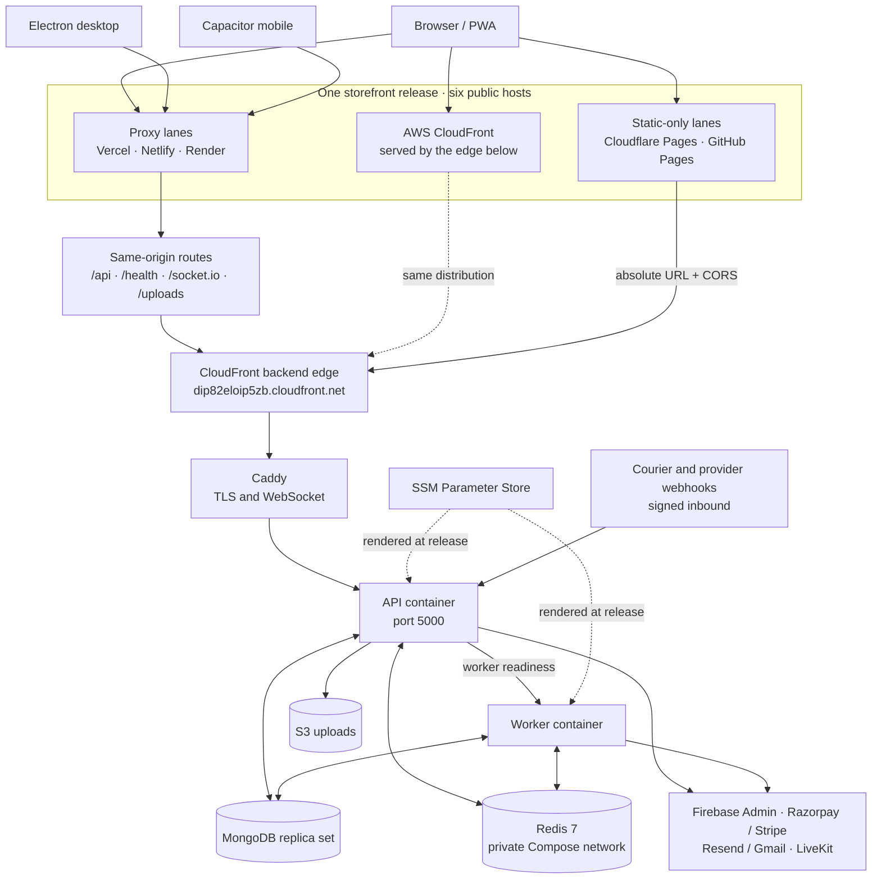
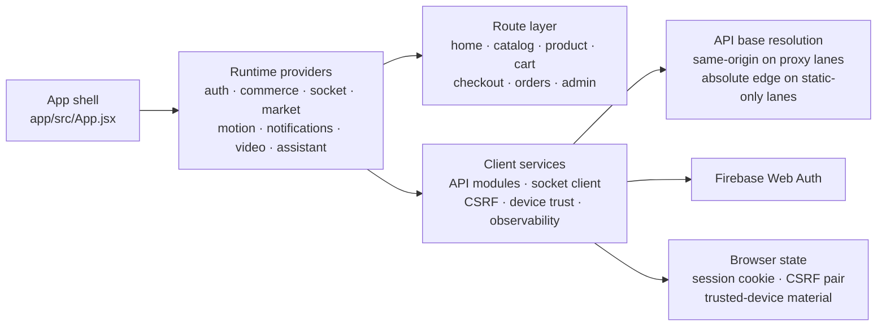
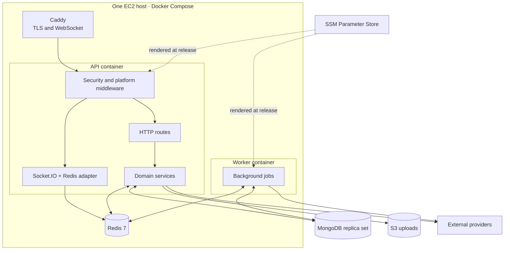
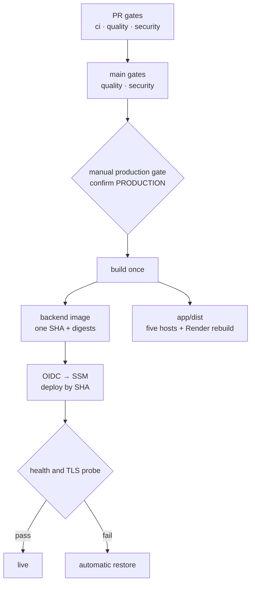

# System Architecture

Aura runs one static storefront release on six public hosts, a separate static
gateway, and one split backend runtime on AWS. The storefront release is identical
across hosts; only the API routing differs.

Vercel, Netlify, and Render proxy runtime paths same-origin to the shared
CloudFront edge. The AWS CloudFront host is that edge: S3 serves the build and
the runtime behaviors forward to Caddy on one EC2 host. Cloudflare Pages and
GitHub Pages have no proxy layer and call the same edge directly. All runtime
entrypoints converge there; Caddy proxies the API container, and the worker runs
beside it from the same immutable image. MongoDB, S3, Parameter Store, and
provider APIs sit outside the host.

Production runs the commerce assistant without an LLM.

The visual version of this page is
[`docs/assets/readme/system-overview.svg`](assets/readme/system-overview.svg).
If the two disagree, treat the code and deployment configuration linked under
[Authoritative sources](#authoritative-sources) as correct and fix both.

## Runtime at a glance

| Layer | Production reality |
|---|---|
| Storefront artifact | `app/` builds to `app/dist`. Five hosts receive that artifact; Render rebuilds from the same commit and inputs. A byte-coherence gate compares all six results. |
| Proxy lanes | Vercel, Netlify, and Render rewrite `/api`, `/health`, `/socket.io`, and `/uploads` to the shared CloudFront edge. |
| AWS CloudFront host | The same distribution as the backend edge. Its S3 default behavior serves the build; its runtime behaviors forward to Caddy. |
| Static-only lanes | Cloudflare Pages and GitHub Pages call the backend edge with an absolute URL; the backend CORS allowlist admits them. |
| Gateway | A separate static Vercel project at `aura-gateway.vercel.app`. It links to storefronts and verified release downloads and carries no API traffic. |
| Backend entrypoint | CloudFront at `dip82eloip5zb.cloudfront.net`, also the AWS storefront host, with TLS, WebSocket support, and origin-secret verification. |
| Compute | One EC2 host running Docker Compose: Caddy, one API container, one worker container, and Redis 7. API and worker use the same immutable image. |
| Transactional store | MongoDB replica set, reached through `MONGO_URI` from Parameter Store. |
| Uploads | S3 when `UPLOAD_STORAGE_DRIVER=s3`. |
| Secrets | AWS Systems Manager Parameter Store under `/aura/prod/*`, rendered to `runtime-secrets.env` on the host. |
| Identity | Firebase Web Auth and Firebase Admin. Authorization is server-side and session-based. |
| Assistant | Deterministic in production: `AI_MODEL_PROVIDER=disabled`, no fallbacks, no model summary. |
| Release | PR gates, main-branch gates, a manual production confirmation, an immutable image, an OIDC/SSM deploy, and automatic restore on failed health checks. |

## Request path



The gateway is a separate static Vercel project and is not part of this request
path; it only links to storefronts and verified downloads.

The same-origin paths are a hosting contract, not a runtime service. They are
implemented in [`vercel.json`](../vercel.json), [`netlify.toml`](../netlify.toml),
[`render.yaml`](../render.yaml), and the CloudFront cache behaviors created by
[`infra/aws/bootstrap-frontend-cloudfront.ps1`](../infra/aws/bootstrap-frontend-cloudfront.ps1).

The AWS lane is that edge, not a separate proxy tier: its S3 default behavior
serves `app/dist`, and its `/api`, `/health`, `/socket.io`, and `/uploads`
behaviors forward to Caddy. Vercel, Netlify, and Render rewrite to the same
edge hostname.

Cloudflare Pages and GitHub Pages have no same-origin proxy in this repository.
The bundle detects the runtime host and calls the backend edge directly. That
path depends on the backend CORS allowlist, so a new direct-call host is not live
until the runtime config includes it. The detection rules live in
[`app/config/hostedFrontendHosts.mjs`](../app/config/hostedFrontendHosts.mjs) and
[`app/src/services/runtimeApiConfig.js`](../app/src/services/runtimeApiConfig.js).
Keep those lists narrow: a shared hosting suffix trusts every tenant on it.

The CloudFront edge is the supported backend entrypoint. Protected routes require
the `X-Aura-Origin-Verify` secret; a missing secret fails closed with `503
ORIGIN_PROTECTION_MISCONFIGURED`. Health, metrics, and signed provider and status
webhooks stay exempt so probes and inbound payment events still work. The origin
host is not a client entrypoint; do not send storefront traffic to it directly.

Caddy terminates TLS and proxies to the `api-traffic` upstream on port 5000. The
API's published host port is `127.0.0.1:5000`, for host health checks only.
Socket.IO upgrades through CloudFront and Caddy, and uses the Redis adapter for
cross-process coordination. Redis is required in the split runtime; it is not
just a cache.

## Storefront runtime



The same `app/dist` artifact serves the browser, the installable PWA, the Electron
desktop shell, and the Capacitor mobile shells. The hosts differ, not the product
code.

- The Vercel, Netlify, AWS CloudFront, Render, Cloudflare Pages, and GitHub Pages
  lanes are release lanes for one storefront release.
- Netlify, Vercel, and AWS release metadata is compared after production deploys.
  The comparison catches a host serving a different release ID.
- Preview deployments point at the production backend edge. They are frontend
  previews, not backend staging.
- The Electron shell keeps credentials in the OS keychain and uses a loopback
  auth handoff. The Capacitor shells use a concrete navigation allowlist, never
  a wildcard.

## Backend runtime



The API and worker are separate processes from one image:

- **API** runs [`server/scripts/start_api_runtime.js`](../server/scripts/start_api_runtime.js).
  It owns Express routes, middleware, Firebase-authenticated Socket.IO
  entrypoints, browser sessions, uploads, and health endpoints.
- **Worker** runs [`server/scripts/start_worker_runtime.js`](../server/scripts/start_worker_runtime.js).
  It owns the payment outbox, order email, catalog sync, reconciliation,
  analytics and email monitors, and OTP maintenance. It has its own readiness
  probe, surfaced to the API through `WORKER_HEALTH_URL`.

The split keeps HTTP traffic from starving payment and email jobs. It does not
create a second host: both containers, Caddy, and Redis share one failure domain.

### Data and secrets

MongoDB is the transactional store: catalog, carts, orders, payment ledger,
sessions, and idempotency records. `MONGO_URI` must point at a replica-set-capable
deployment.

Redis coordinates rate limits, queues, the Socket.IO adapter, and distributed
security controls. The production Compose stack runs Redis 7 on the private
network.

Uploads use S3 when `UPLOAD_STORAGE_DRIVER=s3`. Runtime secrets come from
Parameter Store under `/aura/prod/*`; the release renders them into
`/opt/aura/shared/runtime-secrets.env` because Compose needs a file. Parameter
Store remains the source of truth, and a release overwrites the rendered file
rather than merging it. `last-known-good` is a rollback pointer, not a runtime
setting.

### Production assistant contract

The AWS production assistant is deterministic. The Compose contract sets:

```text
AI_MODEL_PROVIDER=disabled
AI_MODEL_PROVIDER_FALLBACKS=
ASSISTANT_COMMERCE_REQUIRE_HOSTED_GEMMA=false
ASSISTANT_COMMERCE_MODEL_SUMMARY_ENABLED=false
```

Hosted model keys may exist for other environments or features, but the AWS
production runtime cannot select them while this contract is enforced. Do not
edit the host environment to change model behavior; change the tracked contract,
pass CI, and release through the workflow.

### Health and origin protection

- `GET /health` is the public health probe.
- `GET /health/live` is the liveness variant.
- `GET /health/ready` is protected by `x-health-token` when
  `NODE_ENV=production`.
- The worker exposes its own readiness probe.
- Protected routes require the CloudFront origin secret. Health, metrics, and
  signed provider and status webhooks are exempt.

## State ownership

| Store | Owns | Notes |
|---|---|---|
| MongoDB | Catalog, carts, orders, payment ledger, sessions, idempotency records | Replica set required. `MONGO_URI` comes from Parameter Store. |
| Redis | Rate limits, queues, Socket.IO adapter, distributed security controls | Required in the split runtime. Private Compose network. |
| S3 | User uploads | `UPLOAD_STORAGE_DRIVER=s3`. |
| Parameter Store | Runtime secrets, origin-verification secret, health token, rollback pointer | `/aura/prod/*`; rendered to `runtime-secrets.env`. |
| Browser | Session cookie, CSRF token pair, trusted-device material | Server-side authorization; no client-held authority. |
| Static object storage / CDN | Storefront artifact and release metadata | No API state. |

## Delivery and release



Pull requests run the changed-surface CI, quality, and security gates. A merge to
`main` runs the quality and security matrix; `ci.yml` is pull-request only, so a
merge does not re-run it.

Production is never a side effect of a merge. The manual command center requires
`confirm_production=PRODUCTION` and dispatches the selected lane. The backend
release:

1. Resolves one full commit SHA.
2. Builds the image once and packages the image and infrastructure artifacts.
3. Records SHA-256 digests and captures the active SHA.
4. Rejects a same-SHA redeploy so rollback artifacts stay immutable.
5. Uploads under the release SHA, verifies digests on the host, and takes the
   shared release lock.
6. Stages code and environment files, then validates the trust, no-LLM, Compose,
   and health contracts.
7. Activates all state atomically, recreates API and worker, and verifies local
   readiness plus the TLS edge.
8. Restores the previous state automatically if a post-activation check fails.

The production backend deploy uses the `swap` strategy: recreate, brief downtime,
no blue-green claim. `blue-green` remains disabled until an explicit staging drill
sets `AURA_BLUE_GREEN_ENABLED`; it is not a production toggle.

The frontend workflow builds `app/dist` once and publishes that artifact to
Netlify, Vercel, AWS CloudFront, Cloudflare Pages, and GitHub Pages. Render
rebuilds from the same commit and build inputs. A post-deploy coherence gate
hashes what every host serves, compares release metadata on Netlify, Vercel, and
AWS, and rolls back a lane that fails its check.

The dependency lane is separate from production release. Policy classifies the
PR, a 7-day release cooldown applies to new versions, and an optional fine-grained
PAT lets CI arm auto-merge. It cannot merge past a failing check or branch
protection.

## Failure domains and operating assumptions

- **One EC2 host is the backend failure domain.** API, worker, Caddy, and Redis
  share it. Losing the host takes the backend down. MongoDB, S3, Parameter Store,
  and CloudFront are external.
- **Deploys recreate containers.** Expect brief downtime on the `swap` path.
  Blue-green is not enabled in production.
- **Redis is required.** Removing it is not a valid degradation strategy for the
  split runtime.
- **The gateway is not in the request path.** It is a static directory and cannot
  proxy API traffic.
- **Direct-call hosts depend on CORS.** A host missing from the backend allowlist
  will fail even though the frontend build is correct.
- **Production has no LLM assistant.** Hosted AI providers are optional,
  non-production surfaces.
- **This page is a runtime map, not a network diagram.** VPC layout, WAF planning,
  host hardening, and observability topology live in their own docs.

## Authoritative sources

- [Split runtime deployment](split-runtime-deployment.md)
- [AWS backend deployment](aws-backend-deployment.md)
- [AWS frontend deployment](aws-frontend-deployment.md)
- [CI/CD](ci-cd.md)
- [Environment contract](environment-contract.md)
- [Threat model](security/threat-model.md)
- [`infra/aws/docker-compose.ec2.yml`](../infra/aws/docker-compose.ec2.yml)
- [`vercel.json`](../vercel.json), [`netlify.toml`](../netlify.toml),
  [`render.yaml`](../render.yaml)
- [`app/config/vercelRoutingContract.mjs`](../app/config/vercelRoutingContract.mjs)
- [`app/config/hostedFrontendHosts.mjs`](../app/config/hostedFrontendHosts.mjs)
- [`app/src/services/runtimeApiConfig.js`](../app/src/services/runtimeApiConfig.js)
